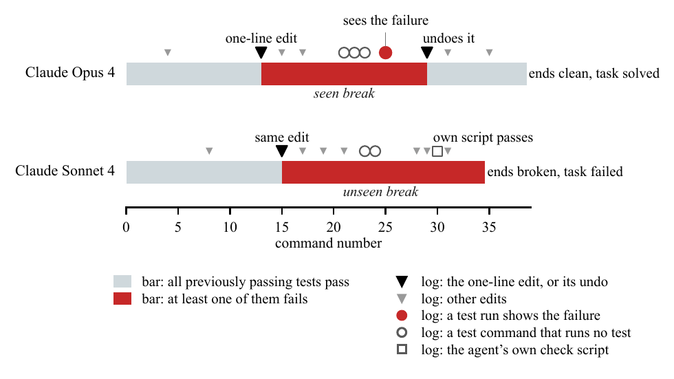
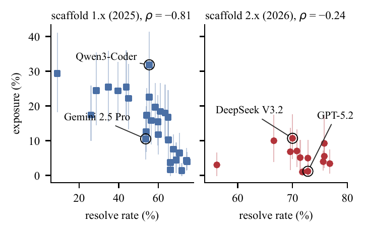

# What the Log Misses

Data and code for the preprint **What the Log Misses: Coding Agents Break Passing Tests Mid-Run, Often Unseen**
(Zanwen Fu, Duke University).

Coding agents are graded by their final patch, and everything else about a run is judged from its log. Both can miss
a regression. A break the agent repairs before it submits leaves no trace in the patch, and the log shows a break only
if the agent runs something that reveals it. We replayed 1,635 published runs of 41 entries on SWE-bench Verified's
bash-only leaderboard, ran the previously passing tests after every command, and compared each break with the log.

<p align="center"></p>

*Two runs make the same one-line edit, which breaks a test that passed before. Opus 4 later runs that test, sees it
fail and repairs the edit, so its final patch hides the break. Sonnet 4 never runs it and submits the break, with
nothing in its log to show it.*

## Findings

- **Breaks are common, and the log misses about half of them.** Over a third of runs break a previously passing
  test, and 55% of these breaks never appear in the log.
- **Agents rarely run the tests.** They check their fix with their own scripts, as the scaffold's instructions
  suggest. Tests ran during only one break in ten, and when they did, the log showed a failing test nine times in ten.
- **Some of these breaks are submitted.** One run in twelve ends on a break its log never showed. Runs that fail only
  because of a previously passing test account for 3.1 points of resolve rate on our tasks.
- **How an agent edits matters.** Edits made with `sed -i` start a break 31% of the time, compared with 13% for edits
  made by a Python script. Entries with nearly the same resolve rate can keep their code broken for very different
  shares of a run.
- **Judges cannot stand in for the tests.** The best model judges that read the log flag most breaks, but the tests
  confirm only about two in five of their alarms.

| | SWE-bench Verified | SWE-bench Multilingual |
|---|---:|---:|
| Runs replayed and kept | 1,557 | 266 |
| Runs that break a previously passing test | 36% | 36% |
| Breaks the log never showed | 55% | 65% |
| Breaks during which any test ran | 10% | 12% |
| Runs that end on a break the log never showed | 8.2% | 5.3% |

<p align="center"></p>

*Share of each run's commands after which the code is broken, against the leaderboard's resolve rate, one point per
entry. Entries with nearly the same resolve rate differ widely.*

Replay needs no model calls. All 1,635 runs took 8.2 hours on one 32-core machine, about $15 of compute, and the
method works for any scaffold that runs each command in its own shell.

## What is here

| Folder | Contents |
|---|---|
| `data/` | Labels for every run, every tested snapshot and every break, on both benchmarks, and the checks behind them |
| `judge/` | The judge prompts, the sampled commands and every judge's raw answers |
| `humancheck/` | The blind human-check cards, keys and labels |
| `paper/` | The scripts that compute every number and figure in the paper |
| `code/` | The replay and labelling code, with its tests |

[DETAILS.md](DETAILS.md) describes every file, the definitions and the scripts that need more than this repository.

## Reproducing the paper's numbers

With Python 3.11 or newer and nothing else installed:

```
bash reproduce.sh
```

This rebuilds every number in the paper from the tables in about 15 seconds and checks each one against the copy the
paper was built from. Redrawing the figures and replaying runs from scratch are covered in [DETAILS.md](DETAILS.md).

## Citation

```bibtex
@misc{fu2026log,
  title  = {What the Log Misses: Coding Agents Break Passing Tests Mid-Run, Often Unseen},
  author = {Zanwen Fu},
  year   = {2026},
  note   = {Preprint}
}
```

## Licence

Code is under Apache-2.0 and the labels and tables under CC BY 4.0. The SWE-bench log parsers and test scripts
included here are SWE-bench's, under MIT (see `NOTICE`). The published runs belong to their submitters and are not
redistributed, apart from the short excerpts needed to check the labels.
